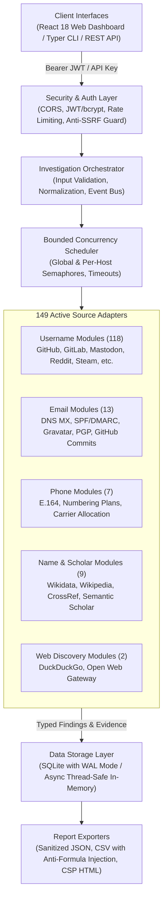
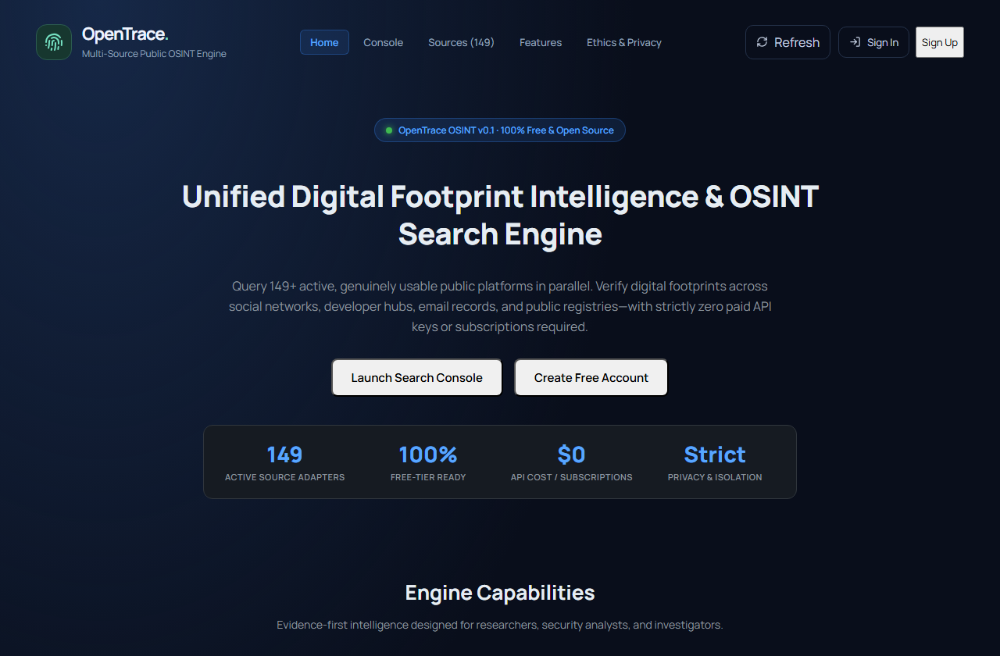
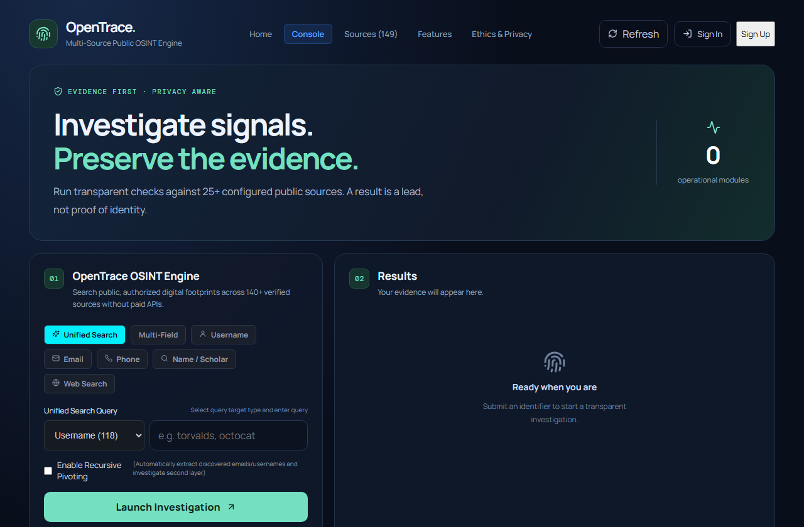
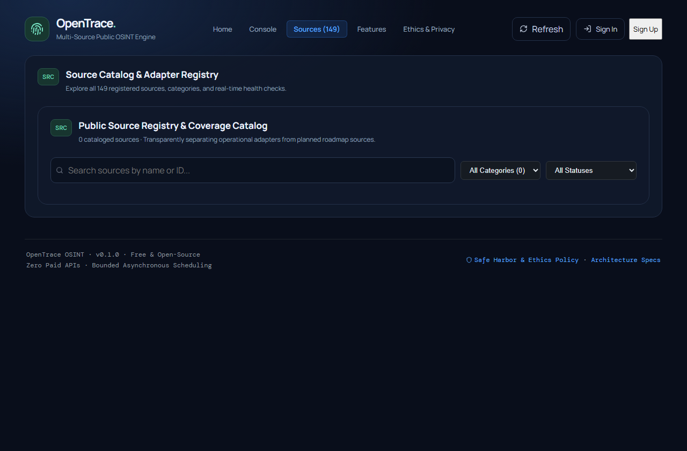

# OpenTrace OSINT

<p align="center">
  
</p>

<p align="center">
  <a href="https://github.com/yut3ev/OpenTrace-OSINT/actions/workflows/ci.yml"></a>
  
  
  
  
  
  
  <a href="LICENSE"></a>
</p>

---

## 1. Overview

**OpenTrace OSINT** is a modular, high-performance, evidence-first digital footprint investigation platform. Inspired by the speed, multi-source breadth, and clarity of modern intelligence tools like Fingerprint.to, OpenTrace performs structured investigations across usernames, email addresses, phone-number metadata, public names, and web sources.

The platform relies **strictly on lawful, public, and open sources** with zero paid API requirements ($0/month operating cost). Every finding includes cryptographic evidence provenance (`SHA-256`), conservative status classifications, and transparent confidence ratings.

---

## 2. Key Features

- **Broad Multi-Source Coverage:** 149 fully registered and tested public source adapters spanning social networks, code repositories, gaming platforms, DNS records, public registries, and scholarly indexes.
- **Evidence-First Provenance:** Every observation captures raw cryptographic hashes (`SHA-256`), canonical target references, HTTP status codes, retrieval timestamps, and transparent confidence ratings.
- **Honest Status Taxonomy:** Distinguishes verified presence (`found`) from clean absence (`no_match`), while explicitly recording service rate-limiting (`rate_limited`), access blocks (`blocked`), network timeouts (`unavailable`), and unsupported inputs (`unsupported`).
- **Strict Tenant & User Isolation:** Scoped database access ensures multi-user environments cannot access other investigators' results. Cross-tenant access triggers HTTP 404 anti-enumeration responses.
- **Anti-SSRF Egress Guard:** Built-in network validation blocks private subnets (`10.0.0.0/8`, `172.16.0.0/12`, `192.168.0.0/16`), loopbacks (`127.0.0.0/8`, `::1`), link-local metadata addresses (`169.254.169.254`), and internal hostnames.
- **Bounded Concurrency & Throttling:** Asynchronous pipeline with global execution bounds (`OPENTRACE_MAX_CONCURRENCY`) and per-host rate limiting (`OPENTRACE_PER_HOST_CONCURRENCY`) to prevent Denial-of-Service against public endpoints.
- **Failed Source Retry Engine:** Re-run failed, rate-limited, or unavailable adapters with a single click without repeating successful checks or losing partial findings.
- **Secure Report Exporters:** Export results to sanitized JSON, CSV (with CSV formula injection protection), and standalone self-contained HTML reports hardened with Content Security Policy (CSP).
- **Unified Tri-Interface:** Web Dashboard (React 18 + TypeScript + Vite + Tailwind CSS), Python CLI (`opentrace` via Typer and Rich), and REST API with live Server-Sent Events (SSE).
- **Zero-Cost Deployment:** Engineered to run on free hosting tiers (Render, Vercel, Railway, Fly.io, Hugging Face Spaces) with bounded memory footprints (~85 MB) and zero paid subscriptions.

---

## 3. Architecture Overview

OpenTrace is built on a clean decoupled architecture separating UI, API, concurrency scheduling, source adapters, and persistence.



---

## 4. Supported Search Types

| Search Type | Canonical Key | Description | Example Target |
|:---|:---|:---|:---|
| **Username** | `username` | Searches across 118 public platforms (dev, social, gaming, blogging) with custom response validation to eliminate soft-404 false positives. | `octocat`, `torvalds` |
| **Email** | `email` | Performs RFC 5321 syntax verification, DNS MX/SPF/DMARC infrastructure audits, throwaway domain checks, public Gravatar profiles, and GitHub commit handle discovery. | `user@example.com` |
| **Phone** | `phone` | ITU-T E.164 normalization, international dial formats, carrier prefix allocation, geographic timezone derivation, and number type validation. | `+14155552671` |
| **Name** | `name` | Encyclopedic identity resolution via Wikidata entities, Wikipedia biographical entries, and scholarly indexing across Semantic Scholar, CrossRef, and arXiv. | `Alan Turing`, `Ada Lovelace` |
| **Web** | `web` | Multi-engine passive discovery via DuckDuckGo Instant Answers and targeted boolean search query formulations. | `example domain`, `security research` |

---

## 5. Source Integrations Catalog

OpenTrace includes **149 active, tested source adapters** operating 100% free with zero paid API dependencies:

- **Username Discovery (118 Platforms):**
  - *Developer & Code Registries (37):* GitHub, GitLab, Bitbucket, Docker Hub, PyPI, npm, Hugging Face, Codeberg, Hashnode, Kaggle, Replit, SourceForge, Packagist, RubyGems, Crates.io, Stack Exchange, Devpost, HackerRank, Codewars, Codecademy, GeeksforGeeks, Topcoder, WakaTime, Hack The Box, Bugcrowd, Launchpad, asciinema, AnkiWeb, freeCodeCamp, Coderwall, Lobsters, MIT Scratch, Exercism, Weblate, Gitea, SourceHut, Pastebin.
  - *Social, Publishing & Communities (45):* Mastodon, Bluesky, Reddit, Keybase, Hacker News, Wikipedia, DEV.to, Medium, Substack, Tumblr, Disqus, Product Hunt, About.me, Linktree, Buy Me a Coffee, Patreon, Pinterest, Flickr, Vimeo, Quora, Discourse Meta, F-Droid Community, Bitwarden Forum, Wikiquote, Wiktionary, Wikivoyage, WordPress.com, Blogger, LiveJournal, Telegra.ph, Vero, Gravatar Profiles, OpenSea, Trello, Scratch Community, Goodreads, Letterboxd, Last.fm, Strava, Duolingo, TryHackMe, LeetCode, Codeforces, Telegram.
  - *Creative, Media & Gaming (36):* Behance, Dribbble, DeviantArt, ArtStation, 500px, SmugMug, Pixiv, Wattpad, Internet Archive, Instructables, SoundCloud, Bandcamp, Mixcloud, Audiomack, ReverbNation, Freesound, Audioboom, Trakt.tv, MyAnimeList, AniList, Chess.com, Lichess, Steam Community, Twitch, itch.io, Speedrun.com, Roblox, osu!, NameMC, Kongregate, Newgrounds, BoardGameGeek, Chessgames, SpigotMC, Nexus Mods.
- **Email Metadata & Security (13 Modules):** RFC syntax validation, DNS MX resolution, disposable domain detection (500+ domains), public Gravatar profiles, SPF/DMARC/DKIM records, GitHub commit attribution, PGP HKP keyservers, CrossRef author DOIs, ICANN RDAP gateway, RFC 9116 `security.txt`, crt.sh Certificate Transparency, and optional authorized verifiers (HaveIBeenPwned, Hunter).
- **Phone Number Analysis (7 Modules):** ITU-T E.164 normalization, international format representations, national carrier prefix allocation, geographic timezone resolution, number validation, and optional authorized verifiers (Numverify, Twilio HLR).
- **Name & Scholarly Records (9 Modules):** Wikidata Q-identities, Wikipedia notable biographies, Wikipedia full-text, Semantic Scholar academic graph, DBLP bibliography, OpenAlex scientific index, CrossRef metadata, arXiv preprints, and search query builder.
- **Public Web Search (2 Modules):** DuckDuckGo Instant Answer API and Open Web Search Gateway.

---

## 6. Screenshots Gallery

<p align="center">
  <b>Landing Page & Ethical Intelligence Overview</b><br />
  
</p>

<p align="center">
  <b>Investigation Dashboard & Search Console</b><br />
  
</p>

<p align="center">
  <b>149-Source Catalog & Status Explorer</b><br />
  
</p>

---

## 7. Technology Stack

- **Backend:** Python 3.11+ / FastAPI / Pydantic v2 / HTTPX / Typer / Rich / bcrypt / PyJWT
- **Frontend:** React 18 / TypeScript / Vite / Tailwind CSS / Lucide React / Axios
- **Storage:** SQLite (WAL mode, foreign keys, versioned migrations) & Thread-safe Async Memory Storage
- **Security & Quality:** Ruff (linter/formatter) / Mypy (strict type checking) / Pytest (136 unit & integration tests) / Playwright (E2E browser tests)
- **Deployment:** Docker / Docker Compose / Multi-stage container builds

---

## 8. Prerequisites

- **Python:** 3.11, 3.12, or 3.13
- **Node.js:** 18.0.0 or higher
- **Git:** Version 2.20+
- *(Optional)* **Docker & Docker Compose** for containerized deployments.

---

## 9. Step-by-Step Installation

```bash
# 1. Clone the repository
git clone https://github.com/yut3ev/OpenTrace-OSINT.git
cd OpenTrace-OSINT

# 2. Set up Python virtual environment
python -m venv .venv

# On Linux/macOS:
source .venv/bin/activate

# On Windows (PowerShell):
.\.venv\Scripts\Activate.ps1

# 3. Install backend with development and test dependencies
pip install -e ".[dev]"

# 4. Install and build frontend assets
cd frontend
npm install
npm run build
cd ..
```

---

## 10. Environment Variables Configuration

Copy `.env.example` to create your local `.env`:

```bash
cp .env.example .env
```

| Variable | Default | Description |
|:---|:---|:---|
| `OPENTRACE_STORAGE_MODE` | `memory` | Storage backend: `memory` (in-memory) or `sqlite` (persistent). |
| `OPENTRACE_SQLITE_PATH` | `opentrace.db` | File path for SQLite database when mode is `sqlite`. |
| `OPENTRACE_MAX_CONCURRENCY` | `5` | Maximum global concurrent adapter executions. |
| `OPENTRACE_PER_HOST_CONCURRENCY` | `2` | Maximum concurrent requests to the same hostname. |
| `OPENTRACE_DEFAULT_TIMEOUT` | `10.0` | Default HTTP timeout per module request (seconds). |
| `OPENTRACE_MAX_RUNTIME` | `60.0` | Maximum overall investigation timeout (seconds). |
| `OPENTRACE_JWT_SECRET` | *(development key)* | Secret key used to sign session JWTs. Change in production! |
| `OPENTRACE_ACCESS_TOKEN_EXPIRE_MINUTES` | `10080` | JWT token validity lifetime (default: 7 days). |
| `OPENTRACE_CORS_ORIGINS` | `http://localhost:5173,...` | Comma-separated list of allowed CORS origins. |
| `OPENTRACE_LOG_LEVEL` | `INFO` | Logging level (`DEBUG`, `INFO`, `WARNING`, `ERROR`). |

---

## 11. Database Setup & Migrations

When using persistent mode (`OPENTRACE_STORAGE_MODE=sqlite`):

- OpenTrace automatically applies database migrations on startup.
- WAL (Write-Ahead Logging) mode and foreign key constraints are enabled automatically.
- Database file defaults to `opentrace.db` in the repository root.
- To reset or re-initialize the database, delete `opentrace.db` or specify a new `OPENTRACE_SQLITE_PATH`.

---

## 12. Running the Application

### Option A: Local Development (Separate Terminals)

**Terminal 1 — FastAPI Backend:**
```bash
uvicorn opentrace.api.app:app --host 0.0.0.0 --port 8000 --reload
```
- API Endpoint: `http://localhost:8000`
- Interactive Swagger UI: `http://localhost:8000/docs`
- ReDoc UI: `http://localhost:8000/redoc`

**Terminal 2 — React Frontend:**
```bash
cd frontend
npm run dev
```
- Web Application: `http://localhost:5173`

### Option B: Docker Compose (Single Command)

```bash
docker compose up --build -d
```
Access the unified application at `http://localhost:8000`.

---

## 13. CLI Usage Examples

The OpenTrace CLI is powered by Typer and Rich:

```bash
# Username investigation across 118 platforms
opentrace investigate -u octocat

# Email metadata and DNS security investigation
opentrace investigate -e user@example.com

# Phone numbering format and carrier prefix lookup
opentrace investigate -p "+14155552671"

# Multi-target combined investigation
opentrace investigate -u octocat -e user@example.com

# Validate all adapters against deterministic fixtures
opentrace validate-sources --fixtures

# Export investigation findings
opentrace export <INVESTIGATION_ID> -f html -o report.html
opentrace export <INVESTIGATION_ID> -f json -o report.json
opentrace export <INVESTIGATION_ID> -f csv -o report.csv

# List all available source modules
opentrace sources list
```

---

## 14. REST API Overview

All protected endpoints accept `Authorization: Bearer <JWT>` or `X-API-Key: <KEY>`.

| Method | Endpoint | Description |
|:---|:---|:---|
| `GET` | `/health` | Service health status and version info |
| `POST` | `/api/v1/auth/register` | Register a new user account |
| `POST` | `/api/v1/auth/login` | Authenticate and obtain JWT access token |
| `GET` | `/api/v1/auth/me` | Retrieve profile of currently authenticated user |
| `POST` | `/api/v1/investigations` | Start a new synchronous or background investigation |
| `GET` | `/api/v1/investigations/{id}` | Retrieve investigation status, findings, and metrics |
| `GET` | `/api/v1/investigations/{id}/events` | Real-time Server-Sent Events (SSE) stream |
| `POST` | `/api/v1/investigations/{id}/cancel` | Cancel an ongoing investigation (retains partial findings) |
| `POST` | `/api/v1/investigations/{id}/retry` | Retry failed, rate-limited, or unavailable adapters |
| `DELETE` | `/api/v1/investigations/{id}` | Delete investigation and associated findings |
| `GET` | `/api/v1/sources` | Filter and search the 149 source manifest registry |
| `GET` | `/api/v1/sources/{id}` | Inspect metadata, limits, and capabilities of a source |
| `GET` | `/api/v1/stats` | Platform coverage metrics and status distribution |
| `GET` | `/api/v1/exports/{id}.json` | Export sanitized JSON investigation report |
| `GET` | `/api/v1/exports/{id}.csv` | Export CSV report with anti-formula injection safeguards |
| `GET` | `/api/v1/exports/{id}.html` | Export self-contained HTML report with CSP protection |

Interactive Swagger documentation is available at [`/docs`](http://localhost:8000/docs).

---

## 15. Testing & Quality Assurance

OpenTrace maintains 100% mocked offline tests to guarantee deterministic CI/CD verification:

```bash
# Run complete test suite (136 tests)
pytest -v

# Run with test coverage analysis
pytest --cov=opentrace --cov-report=term-missing

# Run code style formatting & linting
ruff check .
ruff format --check .

# Run static type checking across all modules
mypy src/opentrace

# Run frontend linting & production build
cd frontend
npm run lint
npm run build
cd ..
```

---

## 16. Troubleshooting Common Issues

- **CORS Errors in Browser:**
  Ensure `OPENTRACE_CORS_ORIGINS` in your `.env` includes `http://localhost:5173` (or your custom frontend host).
- **Port Conflicts (`8000` or `5173` already in use):**
  Change the backend port via `uvicorn opentrace.api.app:app --port 8080` and adjust `frontend/vite.config.ts` proxy settings, or start Vite on another port via `npm run dev -- --port 5174`.
- **Target Rate Limiting:**
  If public services return HTTP 429 (`rate_limited`), decrease `OPENTRACE_MAX_CONCURRENCY` to `2` or `3` and increase `OPENTRACE_DEFAULT_TIMEOUT` to `15.0`.
- **SQLite Database Locked:**
  Ensure multiple processes are not holding exclusive write locks without WAL mode enabled. OpenTrace automatically configures WAL mode on startup.

---

## 17. Security, Ethics & Responsible Use

OpenTrace is built strictly for lawful digital forensics, authorized security investigations, research, and personal privacy audits.

- **Lawful Sources Only:** Only public, unauthenticated web pages or APIs explicitly permitted by terms of service are queried.
- **No Private Probing:** Does not perform SMTP mailbox probing, password cracking, credential stuffing, or paywall/CAPTCHA bypass.
- **Tenant Isolation:** Cross-tenant resource queries return HTTP 404 to eliminate ID enumeration vectors.
- **Correlation Disclaimer:** A username matching across multiple platforms is a candidate discovery, never conclusive proof of common identity. Analysts must manually verify identity links.

For full security policy and vulnerability disclosure instructions, see [SECURITY.md](SECURITY.md).

---

## 18. Known Limitations & Roadmap

- **Soft-404 Detection:** Some web platforms return HTTP 200 responses with custom HTML error pages. OpenTrace uses content pattern heuristics to catch these, but platforms frequently alter their markup.
- **Public IP Throttling:** Cloud providers sharing IP addresses (e.g., shared egress IPs) may experience upstream rate limiting faster than residential IPs.
- **Roadmap:**
  - [ ] Webhook notifications upon investigation completion.
  - [ ] Interactive graph visualization of discovered entity clusters.
  - [ ] Scheduled recurring investigations with diff alerting.
  - [ ] Additional scholarly and code registry adapters.

---

## 19. Contributing

We welcome contributions from the open-source and security research community! Please review [CONTRIBUTING.md](CONTRIBUTING.md) and [CODE_OF_CONDUCT.md](CODE_OF_CONDUCT.md) before opening a pull request or submitting an issue.

---

## 20. License

OpenTrace OSINT is open-source software licensed under the [MIT License](LICENSE).
